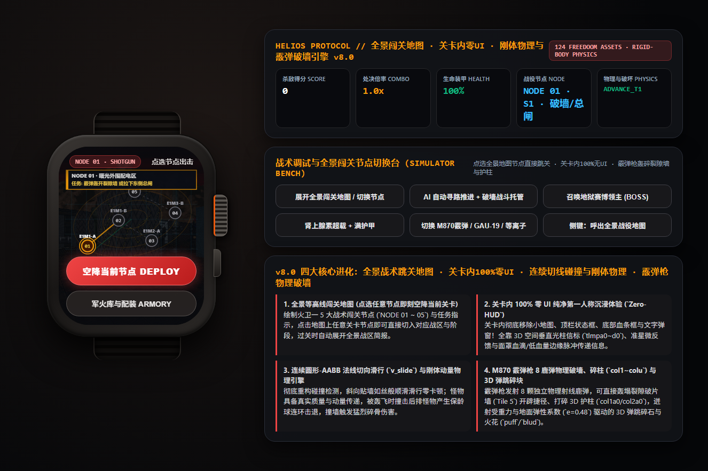
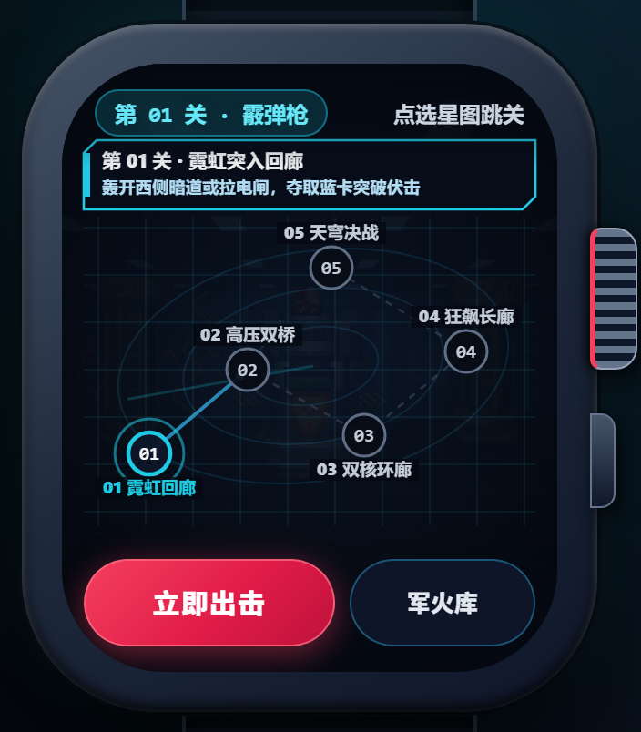
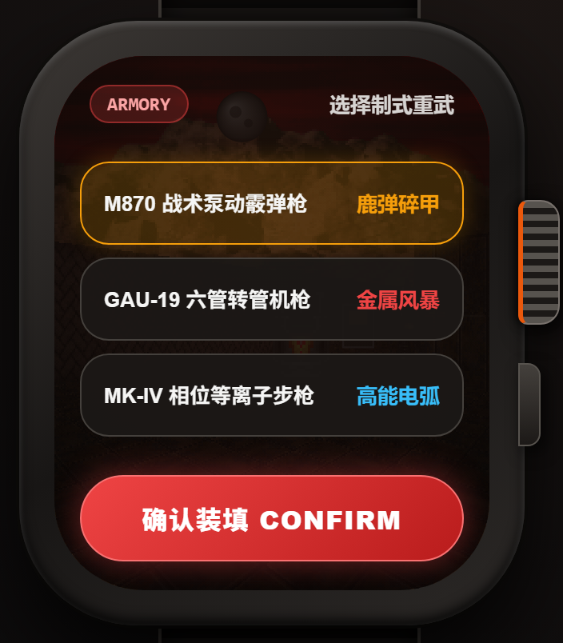
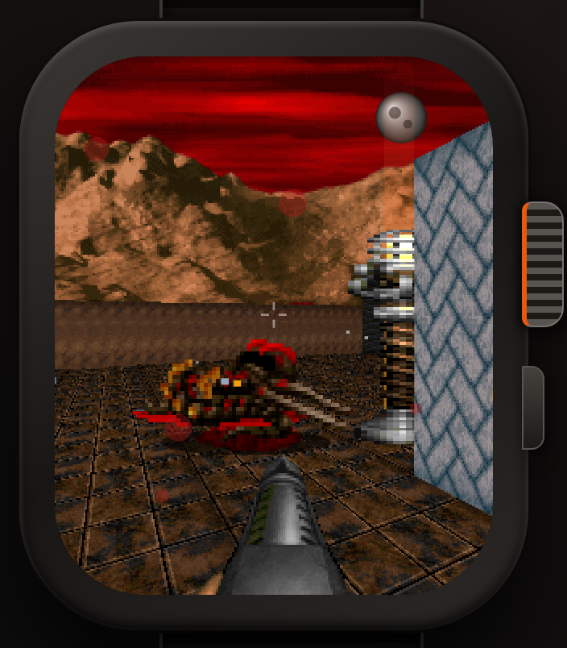
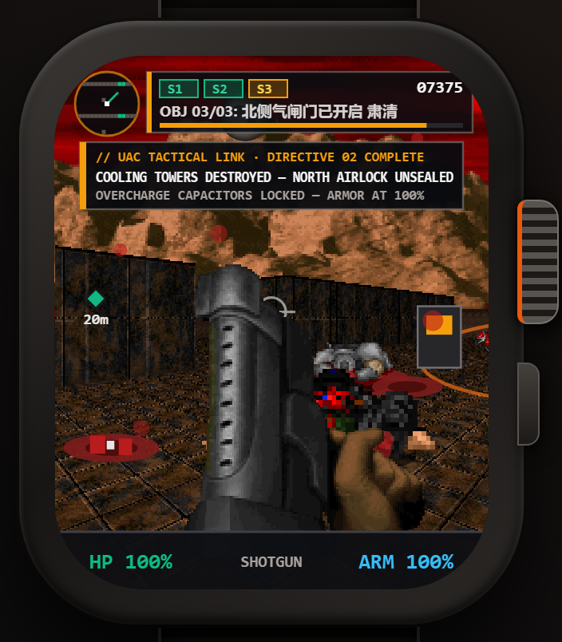
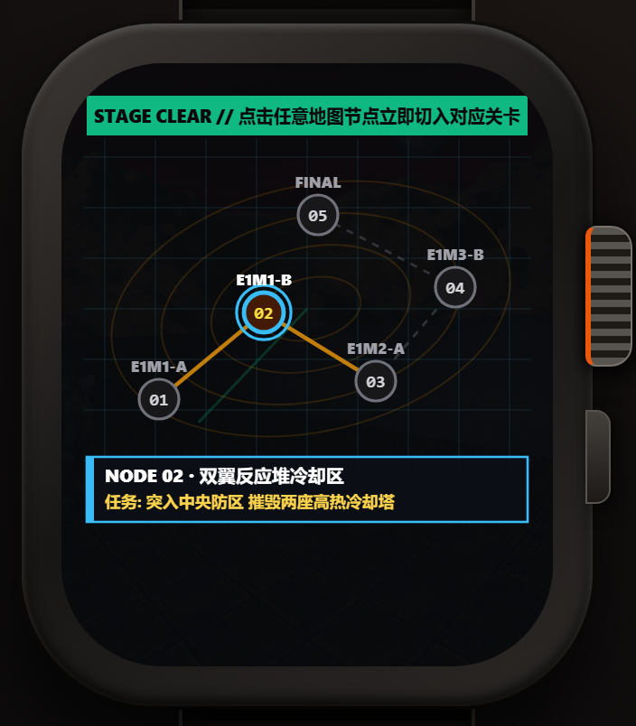

# 曙光协议 · 腕上极速处决第一人称射击模拟器 (v10.0)

> **Apple Watch 独立 2.5D 高反差赛博科幻第一人称射击游戏 (watchOS 10+ SwiftUI Canvas & 2x Retina 网页模拟器)**
>
> *融合《MULLET MADJACK》《ULTRAKILL》《DOOM Eternal》《Bulletstorm》推进式处决爽感与《Selaco》《Prodeus》高反差霓虹工业美学 —— 专为 Apple Watch 腕上微操与桌面键鼠爽快闯关打造*



---

## 一、 v10.0 核心进化：FPS 的“爽感”与手工关卡重塑

针对经典微屏 FPS 容易陷入“画面灰暗廉价、房间千篇一律、缺乏进攻欲望”的痛点，`v10.0` 从**视觉审美、手工关卡拓扑、多巴胺战斗闭环**三个维度进行了彻底重构：

### 1. 高反差赛博工业审美 (`Selaco` / `Prodeus` 美术管线)
- **深冷靛蓝装甲材质 + 锐利霓虹灯带**：摒弃陈旧浑浊的棕黄泥巴色贴图，将 124 项 `Freedoom + Aquatex` 表面重构为**深冷板岩靛蓝 (`Slate-Indigo`)、黑曜石枪铁 (`Obsidian Gunmetal`) 与超导冷却格栅 (`Slot 13`)**，并逐关卡配置**有色指数景深雾 (`fogColor`)**，让猩红碎肉、滚烫黄铜弹壳、青金电弧与飞散魂珠在深色金属背景上极具视觉冲击力。
- **45° 斜切角全息战术界面 (`drawChamferedBox`)**：全面淘汰简陋的直角方框与生硬系统彩色表情符号，升级为拉丝钛金属工作台、全息星图选关视窗、斜切角特技勋章飘带与单色几何矢量微标（`✦` / `◈` / `❖` / `▲`），100% 纯净简体中文呈现。

### 2. 四位一体 FPS 核心爽感闭环（让人每一秒都想冲上去杀敌）
- **战术冲刺重踢 (`triggerDashKick` — 鼠标右键 / `Shift` / `C` 键)**：瞬间爆发 `8.8 m/s` 喷气突进与动态广角视场 (`FOV Surge`)，挥出第一人称重装钛合金战靴：
  - **飞桶保龄轰杀 (`❖ 飞桶轰杀 +400`)**：将核废料爆炸桶当保龄球一脚踹进怪群触发连环殉爆。
  - **高压电网处决 (`❖ 电网处决 +400`)**：借鉴《Bulletstorm》，将恶魔一脚踹上关卡内的**高压等离子电网墙 (`Tile 12`)** 或**裂隙破片墙 (`Tile 10`)**，瞬间触发电弧碎尸或撞塌墙体贯杀！
- **贴脸满贯轰碎 (`✦ 贴脸轰碎 +300`)**：霰弹枪 `< 2.65m` 贴脸齐射触发 `1.75×` 毁灭伤害、`55ms` 顿帧 (`Hit-Stop`)、视场冲击与直接满贯碎尸 (`gibCorpse`)。
- **蓄力弱点打断弹反 (`❖ 弱点打断 +280`)**：怪物攻击前胸口亮起青金菱形蓄力光环，抓准时机开枪或重踢即可打断施法并引爆 `4.2m` 电磁震爆波眩晕全场！
- **推进式磁吸鲜血魂珠 + 六阶血怒狂飙 (`凡铁 → 锋芒 → 喋血 → 暴走 → 杀神 → 极意`)**：越近身残暴处决，喷涌出的磁吸魂珠 (`lootOrbs`) 越多，自动划出弧线飞入枪膛回血回甲，并推升最高 `+30%` 移速、`+32%` 射速、更宽广视场与加速重工业低音鼓点！

### 3. 五张纯手工异构 `24×24` 关卡蓝图 (`BP_01` ~ `BP_05`)
彻底废除单模板套皮地图，每关均采用独立 ASCII 建筑拓扑、专属环境杀阵与经典《DOOM》暗门伏击 (`Monster Closet`)：

| 关卡代号 | 战区名称 | 空间拓扑与关卡设计亮点 | 专属爽点与环境处决 |
| :--- | :--- | :--- | :--- |
| **第 01 关** | `霓虹突入回廊` | 折角突入走廊 + **西侧隐藏破墙包抄暗道** + 夺取蓝卡瞬间开启东侧**暗门伏击 (`DOOR_TRAP`)** | 轰开裂隙墙绕后奇袭 + 中央等离子电柱踢怪处决 |
| **第 02 关** | `高压熔炉双桥` | 三车道悬空冷却格栅窄桥，夹在两道纵向**高压等离子电网脊柱 (`Tile 12`)** 之间 | 窄桥连环重踢将重装机兵成片踹进两侧电网化为血雾 |
| **第 03 关** | `极寒双核环廊` | 敞开式赛博极光天穹 (`AURORA`) + **360° 环形涡轮弹射走廊**包夹双核掩体 | 踩踏涡轮加速垫高速环绕机动，轰爆东西两座高热反应核 |
| **第 04 关** | `狂飙处决长廊` | 南侧双连加速弹射跑道直冲中央占领擂台，四壁环绕高压电网与 `50%` 充能双侧伏击 | 高速驻守超载圈，用重踢与飞桶把涌入擂台的恶魔踹向四周电网 |
| **第 05 关** | `绯红天穹角斗场` | 血月敞开式八角角斗场 + 四角弹射垫 + 四根可轰塌掩体石柱 + **击杀领主解锁北门** | 高能等离子步枪与弹反震爆决战巨型深渊赛博领主 (`BOSS`) |

---

## 二、 实机运行截图 (Apple Watch Ultra 272×334 视口)

| 全息星图选关 (`01_menu_home`) | 战术军火库 (`02_menu_armory`) |
| :---: | :---: |
|  |  |

| 重踢飞桶与特技连杀 (`03_gameplay_early_2s`) | 贴脸轰碎与磁吸魂珠 (`04_gameplay_boss_fever`) | 高压等离子电网与破片墙 (`05_gameplay_late`) |
| :---: | :---: | :---: |
|  |  |  |

---

## 三、 目录结构

```text
├── CyberStrideSimulator.html            # 60FPS 2x Retina 网页版 Apple Watch Ultra 模拟器 (主入口)
├── assets/
│   ├── freedoom_assets.js               # 124 项 Freedoom + Aquatex 开源纹理与精灵资源包 (BSD-3-Clause)
│   └── freedoom/                        # 原始 PNG 贴图、怪物/武器/破坏柱/开关精灵与 LICENSE.txt
├── Preview/
│   ├── CyberStrideSimulator.html        # 模拟器同步预览副本
│   └── playtest_output/                 # 自动化无头浏览器实机测试截图与 HIG 审计报告
├── WatchApp/
│   ├── CyberStrideApp.swift             # watchOS App 入口
│   ├── CyberStrideEngine.swift          # CoreMotion 腕部俯仰 + Digital Crown 转向 + DDA 射线引擎
│   ├── CyberStrideWatchView.swift       # SwiftUI 战术视图层
│   └── CyberStrideWatchCanvasView.swift # watchOS 10+ SwiftUI Canvas + TimelineView 60FPS 渲染实现
└── project.yml                          # XcodeGen 工程配置文件 (watchOS 10.0+)
```

---

## 四、 快速上手操作指南

直接用现代浏览器（Chrome / Edge / Safari）打开根目录下的 `CyberStrideSimulator.html` 即可即开即玩：
- **全息星图跳关**：在表盘星图界面点击 `01` ~ `05` 任意战区节点直接切入对应手工关卡。
- **移动与丝滑擦墙**：按 `W` / `A` / `S` / `D` 或上下方向键前后推进、左右平移。
- **1:1 精准瞄准**：在表盘画面上**按住鼠标左键横向拖拽**、滚动鼠标滚轮、拖拽右侧数码表冠，或按左右方向键转向。
- **开火与贴脸处决**：点击/按住鼠标左键或按 `空格` 键开火；按数字键 `1` / `2` / `3` 切换霰弹枪、加特林与等离子步枪。
- **战术冲刺重踢**：点击**鼠标右键**（或按 `Shift` / `C` / `F` 键），发动高速突进重踢——踹爆裂隙暗墙、踹飞爆炸桶、将恶魔踹上高压电网电弧处决！
