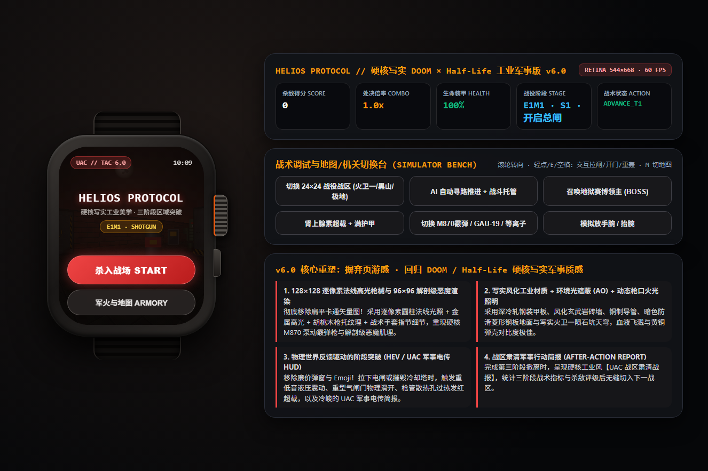
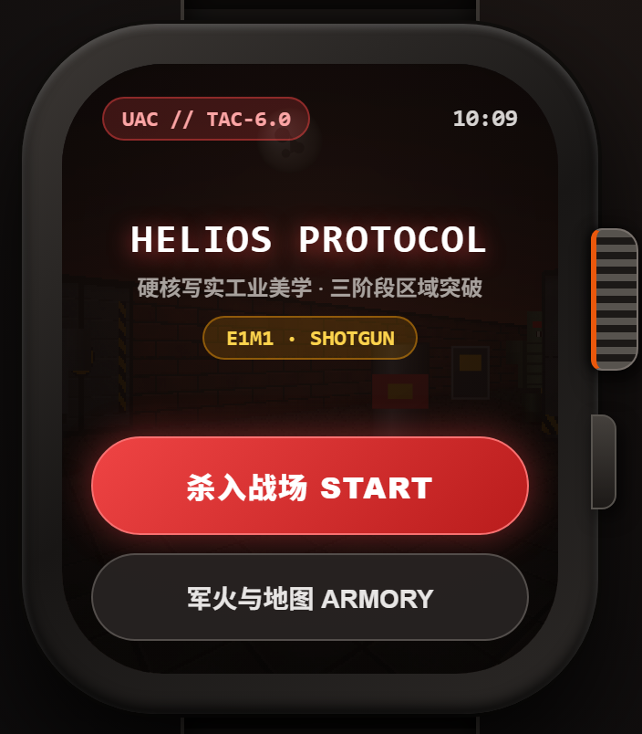
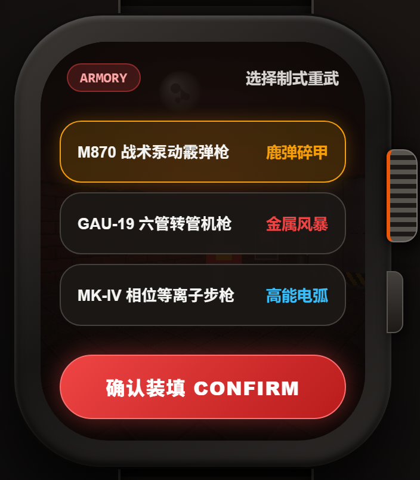
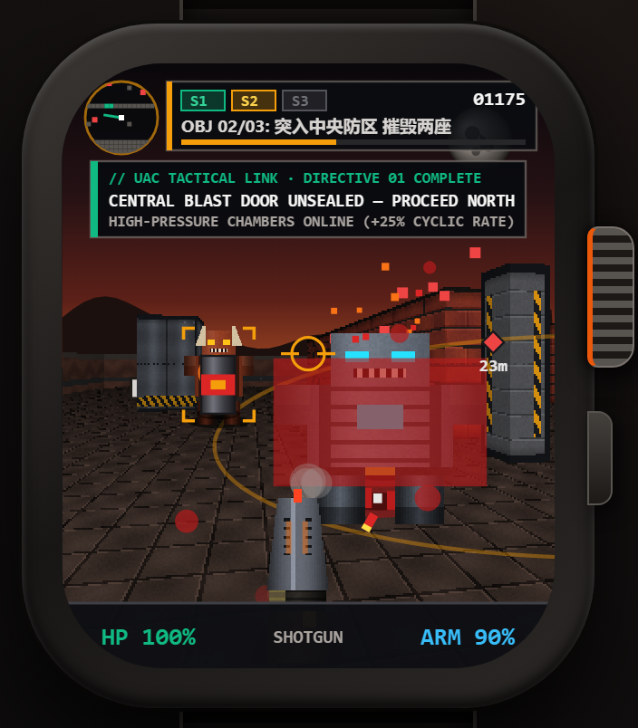
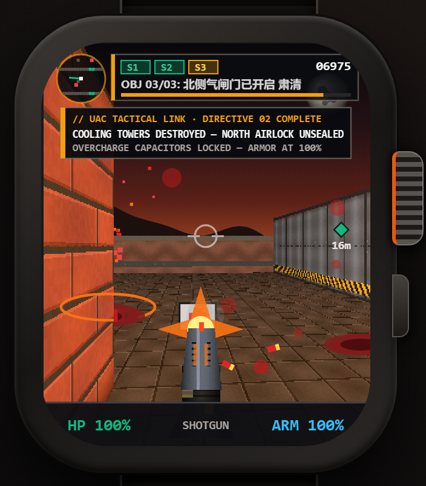
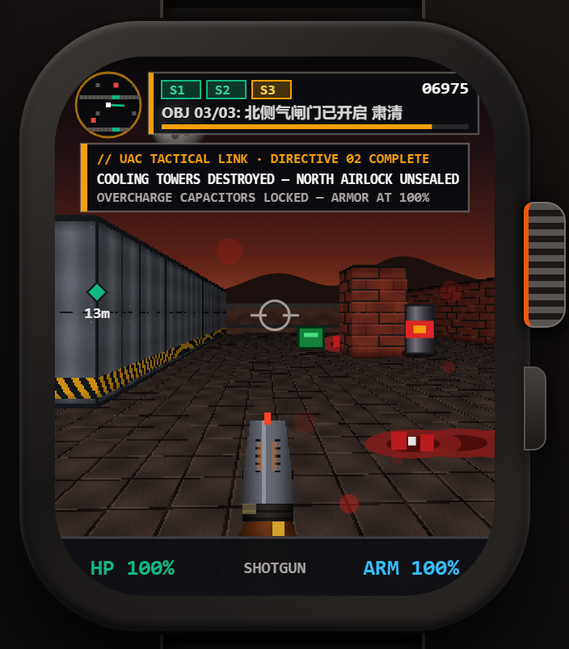

# HELIOS PROTOCOL // UAC TACTICAL EDITION (v6.0)

> **Apple Watch 独立 2.5D 硬核写实军事科幻第一人称射击游戏 (watchOS 10+ SwiftUI Canvas & Retina Web Simulator)**
>
> *Inspired by DOOM (1993 / 2016) & Half-Life — Built for Apple Watch Digital Crown & CoreMotion Wrist Pitch*



---

## 1. 视觉与架构核心 (v6.0 Hardcore Military Sci-Fi Overhaul)

- **128×128 逐像素法线高光与环境光遮蔽 (AO) 工业材质 (`generateAllTextures`)**
  - **风化火卫一玄武岩砖墙 (`Tile 1`)**：带 3D 凹凸倒角、弹孔裂纹、烟熏污渍与底部环境光遮蔽 (AO)。
  - **重型冷轧钢装甲隔舱壁 (`Tile 2`)**：拉丝枪铁金属光泽、工业铆钉、深琥珀黑斜纹警示带。
  - **液压重型防爆气闸门 (`Tile 3`)**：拉下总闸后触发物理滑开动画与重低音液压震动。
  - **工业高对比度防滑菱形钢板地面 (`Floor 5`)**：深色金属格栅地面，使飞溅血迹、黄铜/红色霰弹弹壳与动态枪口火光对比度极佳。
- **96×96 逐像素圆柱法线光照 3D 恶魔/机甲精灵 (`buildRealisticShadedSprites`)**
  - 彻底摒弃廉价扁平矢量卡通图形，采用逐像素圆柱体法线点积光照 (`Lambertian + Blinn-Phong Specular`) 渲染 **深渊恶魔 (`IMP`)**、**腐化陆战队员 (`MARINE`)**、**重装机甲 (`MECHA`)** 与 **地狱赛博领主 (`BOSS`)**。
  - 支持解剖级胸甲/肋骨高光、弯曲骨角、永久创口血迹 (`wounds`) 与 DOOM 式逐帧血肉崩解倒地动画。
- **128×128 逐像素光线着色第一人称重型枪械 + 陆战队战术手套 (`WEP_0 / WEP_1 / WEP_2`)**
  - **M870 战术泵动式霰弹枪**：双联发蓝钢枪管、通风散热护木、红色光纤准星、胡桃木枪托、橄榄绿碳纤指节战术手套握持，开火后触发多刺枪口爆焰、旋转抛壳、枪口硝烟以及**枪管散热孔过热红光**。
  - **GAU-19 六管加特林转管机枪** & **MK-IV 相位高能等离子步枪**。
- **冷峻硬核 UAC 军事战术面罩 HUD (`renderDOOMWeaponAndHUD`)**
  - 零 Emoji、零浮夸弹窗、零糖果掉宝球，严格采用等宽工业战术字体栈与锐利直角装甲边框。
  - 右上角实时显示三阶段矩阵指示灯 (`[S1] [S2] [S3]`)、当前阶段战术指令与推进进度条；底部采用经典 DOOM 风格装甲状态栏 (`HP` / `WEAPON` / `ARM`)。

---

## 2. 实机截图预览 (Apple Watch Ultra 272×334 视口)

| 主菜单 (`01_menu_home`) | 军火库 (`02_menu_armory`) |
| :---: | :---: |
|  |  |

| 第一阶段突破：液压防爆门开启 (`03_gameplay_early_2s`) | 第二阶段突破：冷却塔摧毁与死尸血泊 (`04_gameplay_boss_fever`) | 第三阶段：防卫线圈与北侧撤离 (`05_gameplay_late`) |
| :---: | :---: | :---: |
|  |  |  |

---

## 3. 24×24 三阶段立体战役地图 (`LEVEL_CONFIGS`)

每张 `24×24` 战区均划分为 **南侧登陆区 (Stage 1) → 中央核心防区 (Stage 2) → 北侧撤离指挥台 (Stage 3)**，由两道物理滑动防爆气闸门 (`DOOR_A`, `DOOR_B`) 隔开：

1. **`E1M1` · 曙光峡谷基地 (`HELIOS CANYON`)** — 敞开式火卫一峡谷与陨石坑天穹 (`Phobos Moon Skybox`)
   - **S1**：寻路前往东南配电室，拉下总控断路器开启中央防爆门（解锁高压膛室 `+25%` 射速）。
   - **S2**：突入中央防区，轰爆东西两翼反应堆冷却塔 (`0/2`) 开启北侧气闸门。
   - **S3**：肃清地狱赛博领主，登上北侧撤离升降梯完成战区简报 (`UAC After-Action Tactical Report`)。
2. **`E1M2` · 黑山反应堆深渊 (`BLACK MESA CORE`)** — 半条命风格工业反应堆走廊
   - **S1**：启动应急配电闸门 → **S2**：夺取中央安全门禁磁卡 → **S3**：肃清残敌并撤离。
3. **`E1M3` · 极地天穹前哨 (`HORIZON OUTPOST`)** — 极地天穹开放战区
   - **S1**：解除南侧封锁墙 → **S2**：驻守中央核心完成 `100%` 超载上传 → **S3**：最终传送撤离。

---

## 4. 目录结构 (Repository Layout)

```text
├── CyberStrideSimulator.html        # 60FPS 2x Retina 网页版 Apple Watch Ultra 模拟器 (主入口)
├── Preview/
│   ├── CyberStrideSimulator.html    # 模拟器预览副本
│   └── playtest_output/             # 自动化无头浏览器实机测试截图与 HIG 审计报告
├── WatchApp/
│   ├── CyberStrideApp.swift         # watchOS App 入口
│   ├── CyberStrideEngine.swift      # CoreMotion 腕部俯仰 + Digital Crown 转向 + DDA 射线引擎
│   ├── CyberStrideWatchView.swift   # SwiftUI 战术 HUD 与交互视图层
│   └── CyberStrideWatchCanvasView.swift # watchOS 10+ SwiftUI Canvas + TimelineView 60FPS 渲染实现
└── project.yml                      # XcodeGen 工程配置文件 (watchOS 10.0+)
```

---

## 5. 快速运行指南 (Quick Start)

### 方式 A：直接运行交互式 Apple Watch Ultra 网页模拟器
无需安装 Xcode，直接用现代浏览器（Chrome / Edge / Safari）打开根目录下的 `CyberStrideSimulator.html`：
- **转动表冠 / 鼠标滚轮 / 左右方向键 (`A`/`D`)**：360° 战术瞄准转向（瞄准敌人时自动触发阻尼减速与辅助吸附）。
- **手腕前倾 / `W`/`S` 键**：前后战术推进与后撤。
- **轻点屏幕 / 空格键 / `E` 键**：拉下工业电闸、激活高压电弧防卫塔、拾取门禁卡或引爆超载脉冲。

### 方式 B：生成原生 watchOS Xcode 工程
在 macOS 上安装 [XcodeGen](https://github.com/yonaskolb/XcodeGen) 后执行：
```bash
xcodegen generate
open HeliosProtocolWatch.xcodeproj
```
选择 **Apple Watch Series 9 / Ultra 2 Simulator** 即可编译运行。
